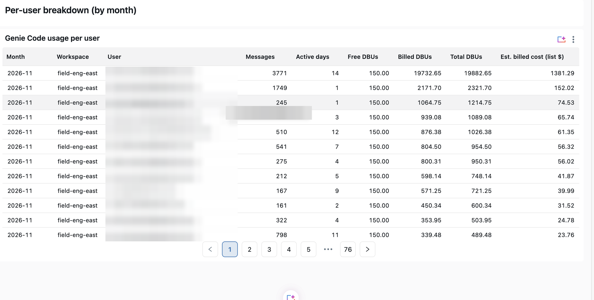

# Genie Code Usage Dashboard

An AI/BI dashboard that tracks Genie Code usage per user: messages sent, free-allowance DBUs, billed DBUs and estimated cost. An optional second page groups usage by task type (for example, building a dashboard or analyzing data) and assigns each type a Low, Medium or High cost tier. Optional per-user alerts email each user when they reach 50% of their monthly limit.

It uses only Databricks system tables. Viewers do not need access to system tables.




Screenshots are from a Databricks demo workspace. User names are redacted.

## Contents

| Path | Purpose |
|---|---|
| `build.py` | Generates the dashboard file (`.lvdash.json`) for your workspace IDs |
| `task_classification/*.sql` | Optional. Classifies Genie Code tasks and estimates cost per task |
| `task_classification/render.py` | Fills your table names and workspace IDs into the SQL above |
| `alerts/sync_user_alerts.py` | Creates one alert per user that emails them at 50% of their monthly limit |

## Part 1: Per-user usage

### Data sources

| Measure | Table | Filter |
|---|---|---|
| DBUs and cost | `system.billing.usage` | `billing_origin_product = 'GENIE'` and `usage_metadata.genie.surface IN ('GENIE_CODE', 'GENIE_CODE_CLI')` |
| List prices | `system.billing.list_prices` | Matched by SKU and date |
| Messages | `system.access.assistant_events` | One row per message sent to Genie Code |
| Workspace names | `system.access.workspaces_latest` | Display only |

Messages and cost are separate measures. A message count does not translate directly into cost.

### How the per-user numbers are calculated

For each user, workspace and month:

1. Take Genie Code rows from `system.billing.usage` for the selected workspaces, from 2026-07-01 onward. The user is `identity_metadata.run_as`.
2. Split each row by SKU:
   - Free DBUs: rows where `sku_name = 'GENIE_FREE_USAGE'`.
   - Billed DBUs: all other Genie Code rows (the regional Serverless Real-Time Inference SKU).
3. Price the billed rows. Join to `system.billing.list_prices` on `sku_name`, `cloud` and `usage_unit`, where `usage_end_time` falls between `price_start_time` and `price_end_time`. Then:

   ```
   est_cost_usd = billed_dbus × pricing.effective_list.default
   ```

   Free rows have no list price and count as $0.
4. Sum free DBUs, billed DBUs and estimated cost by day, then by month.
5. From `system.access.assistant_events`, count messages per user (`initiated_by`) per day. Active days is the number of distinct days with at least one message.
6. Combine the cost and message results on month, workspace and user with a full outer join. A user who has messages but no billed usage, or the reverse, still appears, with the missing values set to 0.
7. Total DBUs = free DBUs + billed DBUs.

The summary tiles at the top are sums of the same daily data over the selected date range. Active users is the number of distinct users who sent at least one message in that range.

### Deploy

```bash
# Find your workspace ID in the workspace URL (?o=<id>) or in system.access.workspaces_latest
python3 build.py 1234567890123456 genie_code_usage.lvdash.json

# Multiple workspaces
python3 build.py 111,222 genie_code_usage.lvdash.json
```

1. In the workspace, go to Dashboards, then Create, then Import dashboard from file, and select the generated file.
2. Select a SQL warehouse. Serverless is recommended.
3. Publish with the default data setting, Share data permissions. The publisher must be able to read `system.billing.usage`, `system.billing.list_prices`, `system.access.assistant_events` and `system.access.workspaces_latest`. A service principal is recommended as the publisher.
4. Share the published dashboard with your users or group at CAN RUN.

### Access model

- Viewers run the dashboard's fixed queries with the publisher's credentials. They need no grants on system tables and cannot change the SQL.
- The workspace IDs passed to `build.py` are written into every query, so viewers see only those workspaces even though the system tables cover the whole account.
- Users who only need to view dashboards can be given the Consumer access entitlement.
- Every viewer can see every user's usage. If that is a concern, share the dashboard with managers only.

## Part 2 (optional): Cost by task type

Groups Genie Code tasks into types: Build dashboard, Analyze or explore data, Write or edit code, Debug or fix errors, Build data pipeline, Build ML model or agent, Explain or answer a question, and Other. For each type it shows the estimated DBUs per task and a cost tier.

### Prerequisite

Turn on Genie Code tracing, which is in Beta. See [Genie traces](https://docs.databricks.com/aws/en/ai-gateway/genie-traces).

- Account admin: enable the Enhanced Unity Gateway beta on the account console Previews page.
- Metastore admin: set up the unified trace table.
- Workspace admin: enable the Genie Code Tracing preview.

### How cost per task is calculated

Billing records Genie Code usage per user per hour and does not include a task ID. Cost per task is therefore an estimate: each user's hourly DBUs are split across the tasks that user started in that hour.

1. Build one row per task (`01_genie_code_turns.sql`). Each Genie Code turn is one trace in the trace table. From the root span, take the user (`enduser.id`), workspace, start time, duration and prompt. From the child spans, count model calls (spans named `chat`) and tool calls (spans named `tool.execute:<tool>`), and sum input and output tokens where they are recorded.
2. Classify each task (`02_classify_tasks.sql`). Run `ai_classify` on the tools used plus the first 4,000 characters of the prompt. Only new tasks are classified, and only once they are at least 2 hours old, so that all of their spans have arrived. The table stores the category and metrics, not the prompt.
3. Assign each task a weight (`03_task_cost.sql`):
   - If every task the user started in that hour has token counts, the weight is input tokens + output tokens.
   - Otherwise, the weight is the number of model calls, with a minimum of 1.

   One basis is used per user-hour so that tokens and model calls are never mixed in the same split.
4. Split the hour's DBUs:

   ```
   task_share = task_weight / sum of weights for that user, workspace and hour
   task_dbus  = user's Genie Code DBUs in that hour × task_share
   task_cost  = user's estimated billed cost in that hour × task_share
   ```

5. Report billed hours that have no traced task, for example hours before tracing was turned on, as Unattributed (no trace), so that the totals still match billing.
6. Set tiers from the data (`04_task_tiers.sql`):
   - Across all classified tasks, find the 33rd percentile (p33) and the 67th percentile (p67) of DBUs per task.
   - For each task type, take the median DBUs per task.
   - The tier is Low if the median is at or below p33, Medium if it is at or below p67, and High otherwise.

Example from testing: a user had 0.345 DBUs in one hour, from two tasks with token counts. The dashboard task used 34,800 tokens and the data question used 3,400.

```
dashboard task = 0.345 × 34,800 / 38,200 = 0.314 DBUs
data question  = 0.345 ×  3,400 / 38,200 = 0.031 DBUs
```

### Deploy

```bash
# 1. Fill in your trace table, target schema and workspace IDs
python3 task_classification/render.py my_catalog.my_schema.my_trace_otel_spans my_catalog.genie_usage 1234567890123456 out/

# 2. Run out/01, out/03 and out/04 once in the SQL editor.
#    Schedule out/02_classify_tasks.sql hourly as a SQL file task in a Lakeflow Job.

# 3. Rebuild the dashboard with the task page
python3 build.py 1234567890123456 genie_code_usage.lvdash.json my_catalog.genie_usage
```

To use your own task categories, edit the label list in `02_classify_tasks.sql`.

Grant the dashboard publisher SELECT on `genie_code_task_class`, `genie_code_task_cost` and `genie_code_task_tiers`. Limit `genie_code_turns` to admins, because it contains users' prompts.

## Part 3: Per-user usage alerts

Each user gets an email when their own Genie Code usage reaches 50% of a monthly per-user limit. The email shows only the percentage used, not DBUs or cost. The alert is notification only and does not block usage.

### How it works

`alerts/sync_user_alerts.py` creates one Databricks SQL alert per user. Each alert:

1. Runs this query for one user, scoped to your workspace IDs and the current month (UTC):

   ```
   pct_used = 100 × (user's Genie Code DBUs this month) / per-user monthly limit
   ```

   The user's DBUs are the sum of `usage_quantity` in `system.billing.usage` for `billing_origin_product = 'GENIE'`, surfaces `GENIE_CODE` and `GENIE_CODE_CLI`, where `identity_metadata.run_as` is the user. Free and billed DBUs both count. The query returns only `pct_used`.
2. Fires when `pct_used` is at or above the alert percentage (default 50).
3. Emails only that user. The subject is `Genie Code usage: <pct>% of your monthly limit`.
4. Sends once per crossing. It does not repeat while the user stays above the threshold. On the 1st of the month the percentage resets, the alert returns to OK, and the next crossing sends a new email.

The script never deletes alerts. Running it again updates existing alerts in place, so it is safe to schedule.

### Run it

Locally, with a Databricks CLI profile:

```bash
# Preview
python3 alerts/sync_user_alerts.py --profile my-ws --warehouse-id <warehouse_id> \
  --workspace-ids 1234567890123456 --users ALL_ACTIVE --per-user-limit-dbus 150 --dry-run

# Create or update the alerts
python3 alerts/sync_user_alerts.py --profile my-ws --warehouse-id <warehouse_id> \
  --workspace-ids 1234567890123456 --users ALL_ACTIVE --per-user-limit-dbus 150 \
  --folder /Workspace/Shared/genie_code_alerts
```

In Databricks, add the script as a Python script task in a Lakeflow Job and leave out `--profile`. Schedule the job daily so that new users get an alert.

| Option | Default | Meaning |
|---|---|---|
| `--users` | required | Comma-separated emails, or `ALL_ACTIVE` for every user with Genie Code usage this month |
| `--per-user-limit-dbus` | 150 | Monthly DBU limit per user. 150 is the monthly free allowance |
| `--alert-at-pct` | 50 | Percentage that triggers the email |
| `--cron` | every 4 hours | How often each alert checks, in Quartz cron syntax, UTC |
| `--folder` | home folder | Workspace folder for the alerts |
| `--run-as-sp` | owner | Service principal application ID that the alerts run as |

### Access and scale

- Alerts run as their owner, or as `--run-as-sp` if set. That identity needs SELECT on `system.billing.usage`. Users who receive emails need no data access.
- Recipients must be users in the workspace.
- There is one alert per user, and each one runs a small query on its schedule. For large user counts, use a serverless warehouse and a schedule of every 4 to 12 hours. Billing data only refreshes every few hours anyway.
- Roll out to a small group first, for example `--users alice@example.com,bob@example.com`, before using `ALL_ACTIVE`.

### Limitations

- Usage data lags by a few hours, so an email can arrive after the user has already gone past 50%.
- The per-user limit is the same for every user. To give some users a different limit, run the script separately for those users with their own `--per-user-limit-dbus`.
- For a single alert on the workspace's total spend, a native Genie budget is simpler. See Decisions for your team.

## Assumptions

- Genie Code is billed pay-as-you-go, with a free allowance of 150 DBUs per user per month, starting July 8, 2026. See [Monitor and understand your Genie cost](https://docs.databricks.com/aws/en/genie/monitor-cost).
- Free usage is recorded under SKU `GENIE_FREE_USAGE` with no list price. Billed usage is recorded under the regional Serverless Real-Time Inference SKU.
- The user identifier is the same email in billing (`identity_metadata.run_as`), messages (`initiated_by`) and traces (`enduser.id`).
- Genie Code billing rows cover one-hour windows. This was observed in testing, and Part 2 depends on it.
- System tables are enabled, including the `system.access` and `system.billing` schemas.
- The queries work on AWS, Azure and GCP. Only the regional SKU names differ, and the queries do not depend on them.

## Known limitations

- Cost is estimated at list price, not your contract rate.
- `system.billing.usage` refreshes every few hours, and messages usually arrive within about an hour. Use this dashboard for reporting, not for real-time enforcement.
- Free usage is only recorded from July 20, 2026.
- Cost per task is an allocation, not a measurement. A task that runs past the end of an hour is counted in the hour it started.
- Genie Code tracing and the trace table are in Beta. Trace delivery is best-effort and nothing is backfilled. Genie Code tool names and token attributes are not fully documented, so the SQL treats them as optional. Expect to adjust it on the first run.
- `ai_classify` runs once per new task, which adds a small cost of its own.

## Decisions for your team

1. Who can view the dashboard: everyone, or managers only.
2. Who publishes it. A service principal is recommended.
3. Whether to use Part 2. It requires enabling Beta tracing and storing prompts in a governed table, so check with your security team first.
4. Which task categories to use.
5. Per-user alerts (Part 3): the per-user monthly limit, how often to check, and which users to include.
6. Workspace-wide spend alerts. For one alert at 50% of the workspace's monthly spend, use a Genie budget: in the account console, go to Usage, then Budgets, choose resource type Unity Gateway and tag `databricks-product = genie`. See [Genie budgets](https://docs.databricks.com/aws/en/genie/budgets).

## Validation

- Part 1 queries were run against real system tables in a demo workspace:
  - Totals match the raw billing and message tables.
  - There is one row per user per month.
  - No billed rows are missing a price.
- Part 2 was tested on synthetic trace spans attached to real billing hours:
  - Tasks were classified as expected.
  - The DBU splits matched hand calculations.
  - A trace from another workspace was excluded.
  - Billed hours without a trace showed up as Unattributed.
- Part 2 has not yet been run on real Genie Code traces.

## References

- [Genie Code](https://docs.databricks.com/aws/en/genie-code/)
- [Genie Code system table](https://docs.databricks.com/aws/en/admin/system-tables/assistant)
- [Measure Genie Code impact](https://docs.databricks.com/aws/en/genie-code/impact)
- [Monitor and understand your Genie cost](https://docs.databricks.com/aws/en/genie/monitor-cost)
- [Genie budgets](https://docs.databricks.com/aws/en/genie/budgets)
- [Genie traces](https://docs.databricks.com/aws/en/ai-gateway/genie-traces)
- [Unified trace table reference](https://docs.databricks.com/aws/en/ai-gateway/unified-trace-table-reference)
- [Share a dashboard](https://docs.databricks.com/aws/en/dashboards/share/share)

This is a sample, not an official Databricks product. Review the SQL before using it in production.
