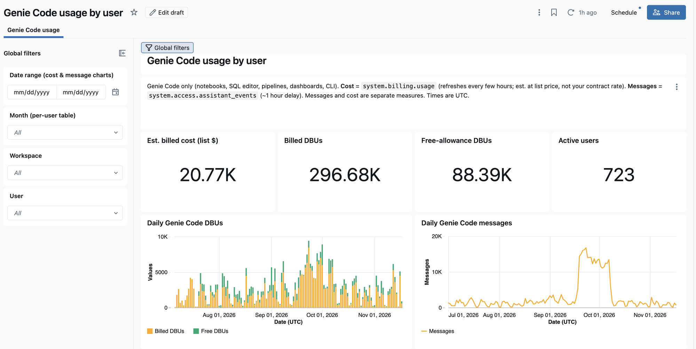

# Genie Code Usage Dashboard

An AI/BI dashboard that tracks **Genie Code usage per user**: messages sent, free-allowance DBUs, billed DBUs and estimated cost. An optional add-on page groups that usage by **task type** (for example, building a dashboard vs. analyzing data) and assigns each type a **Low / Medium / High cost tier**.

It's built only on Databricks system tables. There's nothing to install, and your users can view it without having access to system tables.




*Screenshots are from a Databricks internal demo workspace. User names are redacted.*

---

## What's in the repo

| Path | What it is |
|---|---|
| `build.py` | Generates the dashboard file (`.lvdash.json`) for your workspace ID(s). |
| `task_classification/*.sql` | Optional. SQL that classifies Genie Code tasks and estimates cost per task. |
| `task_classification/render.py` | Fills in your table names and workspace IDs in the SQL above. |

## Part 1: Per-user usage dashboard

### What it shows

| Section | Metric | Source |
|---|---|---|
| Usage totals | Est. billed cost (list $), billed DBUs, free-allowance DBUs, active users | `system.billing.usage`, `system.access.assistant_events` |
| Daily trends | DBUs per day (billed vs. free), messages per day | same |
| Per-user table (by month) | Messages, active days, free DBUs, billed DBUs, total DBUs, est. cost | same |
| Filters | Date range, month, workspace, user | — |

**Usage and cost are separate measures.** Messages come from `system.access.assistant_events`, with one row per message sent in the Genie Code panel or in-cell assistant. DBUs and cost come from `system.billing.usage`, filtered to `billing_origin_product = 'GENIE'` and `usage_metadata.genie.surface IN ('GENIE_CODE', 'GENIE_CODE_CLI')`. Message count doesn't translate directly into cost.

### Deploy

```bash
# 1. Generate the dashboard for your workspace(s). Find the ID in the workspace URL (?o=<id>) or system.access.workspaces_latest
python3 build.py 1234567890123456 genie_code_usage.lvdash.json
#    multiple workspaces: python3 build.py 111,222 genie_code_usage.lvdash.json
```

2. In the workspace, go to **Dashboards → Create → Import dashboard from file** and select `genie_code_usage.lvdash.json`.
3. Choose a SQL warehouse (serverless recommended).
4. **Publish** with **"Share data permissions"** (the default). The publisher must be able to read `system.billing.usage`, `system.billing.list_prices`, `system.access.assistant_events` and `system.access.workspaces_latest`. We recommend a service principal as the publisher.
5. **Share** the published dashboard with your users or group at **CAN RUN**.

### Access model

- Viewers run the dashboard's fixed queries using the **publisher's** credentials. Viewers need **no grants** on system tables and can't edit the SQL.
- The workspace IDs you pass to `build.py` are **hard-coded in every query**, so viewers only see those workspaces, even though the system tables cover the whole account.
- Users who only need to view dashboards can be given the **Consumer access** entitlement.
- ⚠️ **Every viewer sees every user's usage.** If that's a concern, share the dashboard with managers only.

## Part 2 (optional): Cost by task type

This page groups Genie Code tasks into types ("Build dashboard", "Analyze or explore data", "Write or edit code", "Debug or fix errors", "Build data pipeline", "Build ML model or agent", "Explain or answer a question", "Other"). It shows estimated DBUs per task and assigns each type a Low / Medium / High tier.

### How it works

1. **`01_genie_code_turns.sql`** creates a view with one row per Genie Code turn, built from the Genie Code trace table. It includes model calls, tool calls, tokens and duration. **This view contains prompts.**
2. **`02_classify_tasks.sql`** runs incrementally. It applies `ai_classify` to new turns only and stores the **category and metrics only, not the prompt**.
3. **`03_task_cost.sql`** estimates cost per task. Billing has no task ID, so each user's **hourly** Genie Code DBUs are split across that user's tasks in that hour. The split is weighted by tokens, or by model calls if tokens are missing. Billed hours with no traced task are reported as **"Unattributed (no trace)"**.
4. **`04_task_tiers.sql`** sets the tiers from your own data. The cut-offs are the 33rd and 67th percentiles of DBUs per task across all tasks. A task type's tier is where its **median** task falls.

### Deploy

**Prerequisite: turn on Genie Code tracing** (Beta). See [Monitor Genie Code and Genie One with the unified trace table](https://docs.databricks.com/aws/en/ai-gateway/genie-traces).
- Account admin: enable the **Enhanced Unity Gateway** beta on the account console Previews page.
- Metastore admin: set up the **unified trace table**.
- Workspace admin: enable the **Genie Code Tracing** preview.

```bash
# 1. Fill in your trace table, target schema and workspace ID(s)
python3 task_classification/render.py my_catalog.my_schema.my_trace_otel_spans my_catalog.genie_usage 1234567890123456 out/

# 2. Run out/01, out/03, out/04 once (SQL editor).
#    Schedule out/02_classify_tasks.sql hourly as a SQL file task in a Lakeflow Job.

# 3. Rebuild the dashboard with the task page included
python3 build.py 1234567890123456 genie_code_usage.lvdash.json my_catalog.genie_usage
```

To use your own task categories, edit the label list in `02_classify_tasks.sql`.

**Access:** grant the dashboard publisher `SELECT` on `genie_code_task_class`, `genie_code_task_cost` and `genie_code_task_tiers`. **Do not** grant access to `genie_code_turns` beyond admins, because it contains users' prompts.

---

## Assumptions

- Genie Code is billed **pay-as-you-go** with a **150 DBU per-user monthly free allowance**, as of July 8, 2026. See [Monitor and understand your Genie cost](https://docs.databricks.com/aws/en/genie/monitor-cost).
- Free usage is recorded under SKU `GENIE_FREE_USAGE` with no list price. Billed usage is recorded under the regional Serverless Real-Time Inference SKU.
- `identity_metadata.run_as` (billing) and `initiated_by` (messages) are the user's email. `enduser.id` (traces) uses the same identifier.
- Genie Code billing rows cover **one-hour windows**. We observed this in testing, and Part 2's cost split depends on it.
- Workspaces are on Unity Catalog with system tables enabled, and the `system.access` and `system.billing` schemas are available.
- Works the same on **AWS, Azure and GCP**. Only the regional SKU names differ, and the queries don't depend on them.

## Known limitations

- **Cost is estimated at list price**, not your contract rate.
- **Data latency:** `system.billing.usage` refreshes every few hours. Messages usually arrive within about an hour. This dashboard is for reporting, not real-time enforcement.
- **Free usage is only recorded from July 20, 2026**, so earlier free-allowance usage doesn't appear.
- **Cost per task (Part 2) is an allocation, not a measurement.** Tasks that run past the end of an hour are counted in the hour they started.
- **Genie Code tracing and the trace table are in Beta.** Trace delivery is best-effort, nothing is backfilled, and Genie Code tool names and token attributes aren't fully documented. The SQL handles missing values, but expect to adjust it on first run.
- `ai_classify` runs once per new task, which adds a small cost of its own.

## Decisions for your team

1. **Who can view the dashboard?** Everyone, or managers only. Per-user data is visible to all viewers.
2. **Who publishes it?** We recommend a service principal.
3. **Do you want Part 2?** It requires enabling Beta tracing and storing prompts in a governed table. Check with your security and privacy team.
4. **Which task categories?** Edit the list in `02_classify_tasks.sql`.
5. **Spend alerts:** for alerts like "notify at 50% of monthly spend", use a native **Genie budget**: Account console → Usage → Budgets, resource type Unity Gateway, tag `databricks-product = genie`. See [Genie budgets](https://docs.databricks.com/aws/en/genie/budgets).

## Validation performed

- All Part 1 queries were run against real system tables in a Databricks demo workspace. Totals reconcile with raw `system.billing.usage` and `system.access.assistant_events`, there's one row per user per month, and there are no unpriced billed rows.
- Part 2 was tested end to end on **synthetic** trace spans attached to real billing hours:
  - Classification matched the expected task types.
  - Cost splits matched hand calculations.
  - A trace from another workspace was excluded.
  - Billed hours without a trace showed up as Unattributed.
- Part 2 has **not** been run against real Genie Code traces yet.

## References

- [Genie Code](https://docs.databricks.com/aws/en/genie-code/)
- [Genie Code system table (`system.access.assistant_events`)](https://docs.databricks.com/aws/en/admin/system-tables/assistant)
- [Measure Genie Code impact](https://docs.databricks.com/aws/en/genie-code/impact)
- [Monitor and understand your Genie cost](https://docs.databricks.com/aws/en/genie/monitor-cost)
- [Genie budgets](https://docs.databricks.com/aws/en/genie/budgets)
- [Genie traces](https://docs.databricks.com/aws/en/ai-gateway/genie-traces) · [Unified trace table reference](https://docs.databricks.com/aws/en/ai-gateway/unified-trace-table-reference)
- [Share a dashboard](https://docs.databricks.com/aws/en/dashboards/share/share)

---

*Provided as a sample, not an official Databricks product. Review the SQL before running it in production.*
